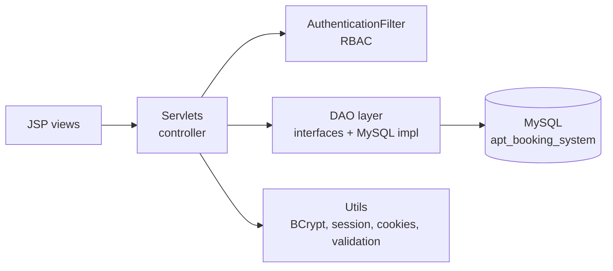

# MeroNepal — event booking system

A Java Servlet/JSP web application for a Nepali event-management business: customers browse
packages, book an event, and pay; admins manage services, packages, bookings, and payments.

Built as a team project for the Advanced Programming Technology module, and the largest
Java codebase in this account: **~50 servlets, DAOs, models, filters, and JSP views**.

> Looking for the per-class API reference? See [`docs/servlet-reference.md`](docs/servlet-reference.md)
> for every servlet mapping, DAO method, and utility class.

## Features

**Customer**
- Register, log in, log out (session + cookie, BCrypt password hashing)
- Browse active packages and the services included in each
- Book an event with an address, note, and date (must be at least 4 days ahead)
- View bookings, cancel a booking with ownership checks
- Edit profile and change password with complexity validation

**Admin**
- Dashboard with user count, booking count, bookings by package, recent bookings
- Create services and packages; link services to packages
- Update booking status (`Pending`, `Confirmed`, `Completed`, `Cancelled`)
- Update payment status (`Unpaid`, `Partial`, `Paid`, `Refunded`) synced from package price
- Soft-delete services, hard-delete package-service links

## Architecture



| Layer | Package | Notes |
|---|---|---|
| Controller | `contoller` (sic) | 20 servlets mapped to JSPs |
| DAO | `dao` + `dao.interfaces` | Interface-first, JDBC implementations |
| Model | `model` | `User`, `Booking`, `Package`, `Service`, `Payment` |
| Filter | `filter` | Session gate and role routing on `/*` |
| Utility | `utils` | `PasswordUtil`, `SessionUtil`, `CookieUtil`, `ValidationUtil`, `DBConfig` |

## Running locally

**Requirements:** JDK 17+, Maven, Tomcat 10+, MySQL 8+.

1. Create the schema and load demo data:
   ```bash
   mysql -u root -p < sql/01_create_database.sql
   mysql -u root -p apt_booking_system < sql/02_dummy_data.sql
   ```
2. Point `DBConfig` at your MySQL instance (URL, user, password).
3. Build and deploy:
   ```bash
   mvn clean package
   # copy target/*.war to $TOMCAT_HOME/webapps/
   ```
4. Open `http://localhost:8080/<war-name>/home`.

Test cases and manual verification steps are recorded in [`TESTCASE.md`](TESTCASE.md).

## Repository note

The repository is ~86 MB because high-resolution portfolio photographs (up to 17 MB each) were
committed under `src/main/webapp/assets/img/`. Compressing those to WebP is the first cleanup
task; the code itself is small.

## Status

Course project, complete and demoable. No CI or automated tests — verification was manual,
documented in `TESTCASE.md`. It is a strong example of layered Java web architecture, not of
modern deployment practice.

## License

Not specified.
